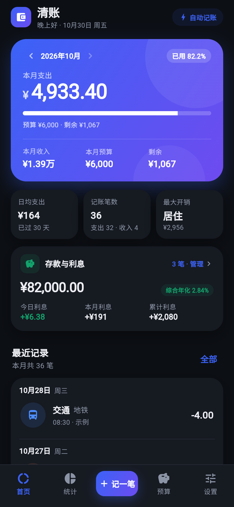
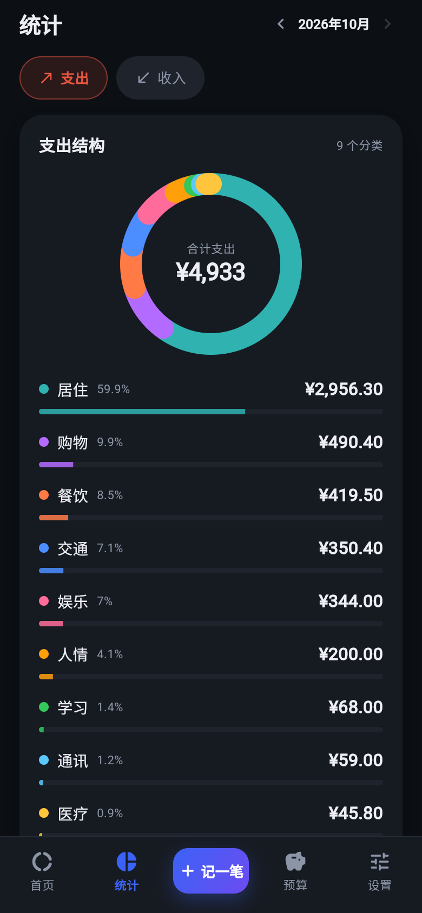
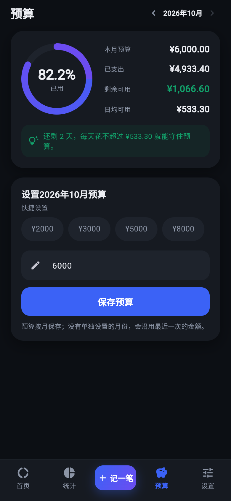
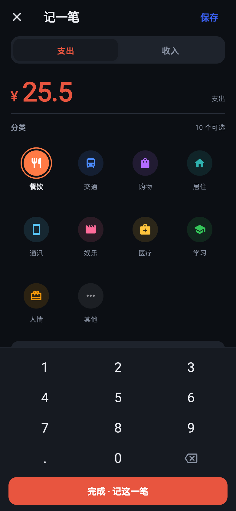
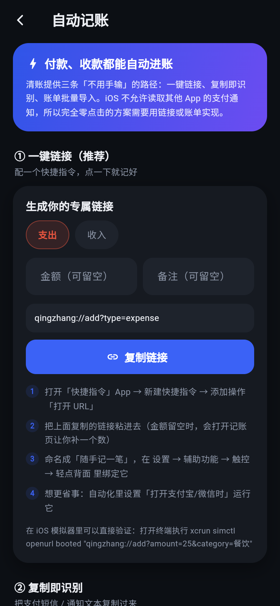
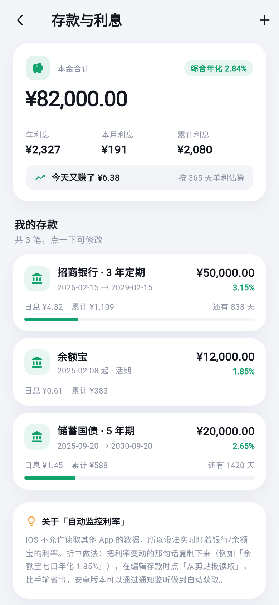
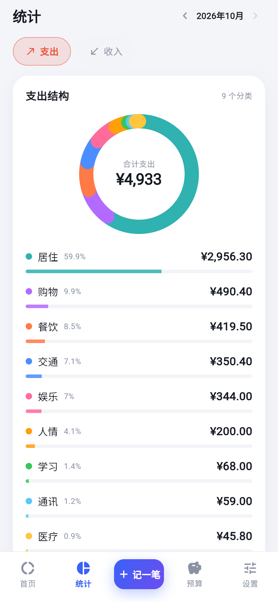
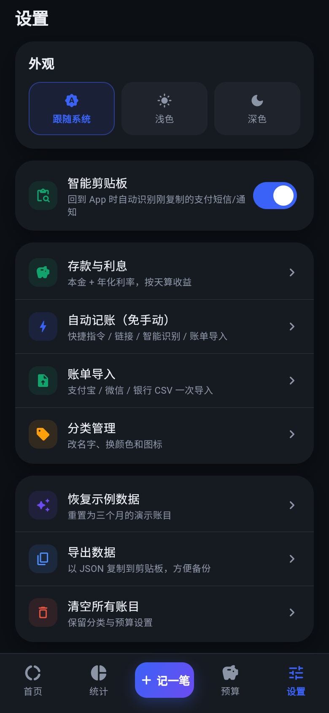

# 清账 · 懒人记账

一个用 Flutter 写的中文移动端记账 App：**记一笔 → 看支出 → 控预算**。
无登录、无后端，所有数据只保存在手机本地。

- 首页：本月收入 / 支出 / 预算 / 剩余，预算进度、日均支出、最大开销、最近记录
- 存款与利息：本金 + 年化利率，自动算日息、本月、累计、到期本息，首页直接看到「今天又赚了多少」
- 记一笔：自定义数字键盘、分类九宫格、常用备注、可改时间、记住上次分类
- 统计：支出/收入结构环图、分类排行、近 6 个月收支趋势
- 预算：环形进度、剩余与日均可用、超支提醒，按月保存
- 设置：跟随系统/浅色/深色、分类管理（改名换色换图标）、数据导出与清空
- 自动记账：`qingzhang://` 深链（带金额直接入账）、智能剪贴板（回到 App 自动识别刚复制的支付信息）、账单 CSV 批量导入
- 首次打开自带三个月示例账目和 3 笔示例存款，开箱即可演示

## 预览

| 首页 | 统计 | 预算 |
| --- | --- | --- |
|  |  |  |

| 记一笔 | 自动记账 | 浅色模式 |
| --- | --- | --- |
|  |  |  |

| 存款与利息 | 浅色-统计 | 深色-设置 |
| --- | --- | --- |
|  |  |  |

图标：

## 验证情况（2026-10-30，Windows）

- `flutter analyze`：0 issue
- `flutter test`：6 个用例全部通过（深链解析、银行短信解析、CSV 账单、金额格式化）
- `flutter build web --release`：构建成功；用 Chrome DevTools 协议按 390×844 视口逐页截图核对（上图）
- 自动记账实测：打开 `?amount=25.5&category=餐饮` 后**没有点任何按钮**即入账，并提示「已自动记账 · 餐饮 25.50 元」
- 未验证：iOS / Android 原生工程（本机没有 macOS 与 Android SDK）。
  `AppDelegate.swift` / `SceneDelegate.swift` / `MainActivity.kt` 按 Flutter 官方 UIScene 生命周期接口编写，
  需要在一台 Mac 上用 Xcode 编译确认。

---

## 一、在 Windows 上预览（这台机器就能跑）

Flutter SDK 已安装在 `C:\flutter-sdk`（没有加进 PATH，用全路径调用）。
> 注意：SDK 一定要放在**纯英文路径**下。放在中文目录里时，着色器编译工具（impellerc）
> 会因为路径编码问题报 `Included file not found: flutter/runtime_effect.glsl`，导致构建失败。

```powershell
cd C:\软件开发\记账软件
C:\flutter-sdk\bin\flutter.bat run -d chrome
```

装的是 Edge 而不是 Chrome 时，用 web 构建 + 任意静态服务器预览：

```powershell
C:\flutter-sdk\bin\flutter.bat build web --release
cd build\web
python -m http.server 8080
# 浏览器打开 http://127.0.0.1:8080
```

> 直接双击 `build\web\index.html` 打不开，Flutter Web 需要 http 服务器。

## 二、在 iOS 模拟器里运行（需要一台 Mac）

**iOS 模拟器只能在 macOS 上运行**，Windows 上无法启动。工程里的 `ios/` 目录已经是完整的 Xcode 工程，拷到 Mac 上即可。

1. Mac 上安装 Xcode（App Store）与 CocoaPods：`sudo gem install cocoapods`
2. 把整个 `记账软件` 文件夹拷到 Mac
3. 安装 Flutter SDK（macOS 版），然后：

```bash
cd 记账软件
flutter pub get
cd ios && pod install && cd ..
open -a Simulator                 # 启动模拟器
flutter devices                   # 确认能看到 iPhone 模拟器
flutter run -d "iPhone 16"        # 设备名换成 flutter devices 里显示的
```

也可以用 Xcode 打开：`open ios/Runner.xcworkspace`，选一个 iPhone 模拟器，点 ▶️。
模拟器运行不需要 Apple 开发者账号。

## 三、在真机上运行

- **iPhone**：Xcode 打开 `ios/Runner.xcworkspace` → 选中 `Runner` target →
  `Signing & Capabilities` 里选自己的 Apple ID Team → 连上手机 → Run。
  免费账号签的 App 有效期 7 天，到期重装即可。
- **没有 Mac**：用 GitHub Actions 云端打未签名 IPA，再在 Windows 上用 Sideloadly 侧载，
  详见 [docs/iOS真机安装指南.md](docs/iOS真机安装指南.md) 与 [.github/workflows/ios-ipa.yml](.github/workflows/ios-ipa.yml)。
- **Android**：装好 Android SDK 后 `flutter run`（USB 调试），或 `flutter build apk --release`
  得到 `build/app/outputs/flutter-apk/app-release.apk` 直接安装。

## 四、把「付款/收款自动记账」用起来

iOS 不允许 App 读取微信、支付宝、银行的支付通知，所以「零输入」靠下面三条路实现，三条都已内置：

### 1）一键链接（最快，1 秒一笔）

App 注册了 `qingzhang://` 链接。带 `amount` 且 `auto` 不为 0 时，**打开链接即入账，不用点任何按钮**。

在 iPhone「快捷指令」里：

1. 新建快捷指令 → 添加操作「打开 URL」→ 粘贴：
   `qingzhang://add?amount=25&type=expense&category=餐饮&note=午餐`
2. 命名为「午餐 25」之类；想更通用就只带分类：`qingzhang://add?category=餐饮`（会打开记账页让你补金额）
3. 绑到「轻点背面两下」：设置 → 辅助功能 → 触控 → 轻点背面 → 轻点两下 → 选这个快捷指令
4. 进阶：快捷指令的「自动化」里设置「打开支付宝时」运行，或用「询问输入」把金额填进链接

测试（模拟器 + 终端）：

```bash
xcrun simctl openurl booted "qingzhang://add?amount=25&category=餐饮"
adb shell am start -a android.intent.action.VIEW -d "qingzhang://add?amount=25&category=餐饮"
```

### 2）复制即识别（适合银行短信 / 支付通知）

把短信或通知文字复制下来 → App 里「自动记账 → 粘贴并识别」，会自动提取
金额、收/支方向、商户、时间，并猜一个分类，确认后入账。

### 3）账单导入（最接近「零手动」的稳定方案）

支付宝、微信、银行导出的 CSV 直接粘贴进「设置 → 账单导入」，一次导入整月流水。
已做去重（同金额同时间视为重复）、跳过「不计收支/已关闭」的订单，GBK 编码的支付宝账单也能读。

实测（链接入账，零点击）：


### 链接参数表

| 参数 | 取值 | 说明 |
| --- | --- | --- |
| `amount` | 25 或 25.50 | 金额，带了就直接入账 |
| `type` | `expense` / `income` | 默认 `expense` |
| `category` | 餐饮、交通、工资… | 分类名，匹配不上会按备注猜 |
| `note` | 任意文字 | 备注 |
| `date` | `2026-03-12` 或 `2026-03-12T14:20` | 默认当前时间 |
| `auto` | `0` / `false` | 只打开记账页并预填，不直接入账 |

## 五、目录结构

```
lib/
  main.dart                 入口
  app.dart                  MaterialApp、主题、深链分发
  theme/app_theme.dart      配色、字号、亮/暗主题
  models/                   分类、账目、月度汇总
  data/app_store.dart       全部状态（ChangeNotifier）+ 本地 JSON 持久化
  data/sample_data.dart     三个月示例数据
  services/auto_entry.dart  深链 / 文本解析、分类猜测
  services/bill_import.dart CSV 账单解析（支付宝/微信/银行）
  services/deep_link_service.dart  MethodChannel + Web 查询参数
  screens/                  首页、记账、统计、预算、设置、自动记账、导入、分类
  widgets/                  卡片、环图、趋势、进度环、账目行、详情面板
ios/Runner/AppDelegate.swift / SceneDelegate.swift  深链原生入口
android/.../MainActivity.kt                         深链原生入口
test/parser_test.dart       解析逻辑单元测试
```

## 六、数据与隐私

- 存储：`SharedPreferences` 里一份 JSON（key `qingzhang.doc.v1`），无网络请求、无账号
- 导出：设置 → 导出数据，整份 JSON 复制到剪贴板，可自行备份
- 恢复示例数据 / 清空账目都在设置里

## 七、已知限制与后续可做

- **iOS 无法监听其他 App 的支付通知**，这是系统限制；要真正「全自动」只能走 Android 的通知监听
  （`NotificationListenerService` 解析微信/支付宝通知，属于原生扩展，本次未做）
- 截图 OCR（iOS Vision 框架 + 分享扩展）可以让「截个图就记好」落地
- 原始需求里的「类别 / 账本 / 标签」三维分类，目前是「类别 + 备注 + 来源」，账本和标签可以作为下一步
- 未做：多币种、周期性账目、iCloud 同步、图表导出图片

## 八、开发常用命令

```powershell
C:\flutter-sdk\bin\flutter.bat analyze      # 静态检查
C:\flutter-sdk\bin\flutter.bat test         # 单元测试
C:\flutter-sdk\bin\flutter.bat build web    # 网页版
```

## 九、仓库里的开发工具（tools/）

| 脚本 | 用途 |
| --- | --- |
| `tools/make_icons.py` | 生成 iOS / Android / Web 全套图标（Pillow） |
| `tools/shot.py` | 用 Chrome DevTools 协议按手机视口批量截图，支持亮/暗色 |
| `tools/verify_action.py` | 验证「打开链接即入账」是否生效 |
| `tools/probe_env.py` | 打印页面视口参数，排查截图尺寸问题 |
